# Student Timer Clock

**Version 0.3 · Windows 10 / 11 (64-bit) · free for personal and school use**

Student Timer Clock is a timer, countdown and stopwatch app for students and teachers. You can:

- count down to an exam
- run a Pomodoro study session
- split a lesson into timed segments
- track how long you really spend on each subject

Timers can float on your desktop as big, easy-to-read widgets. You can show them on a classroom projector, and the app can do something automatically when time is up.

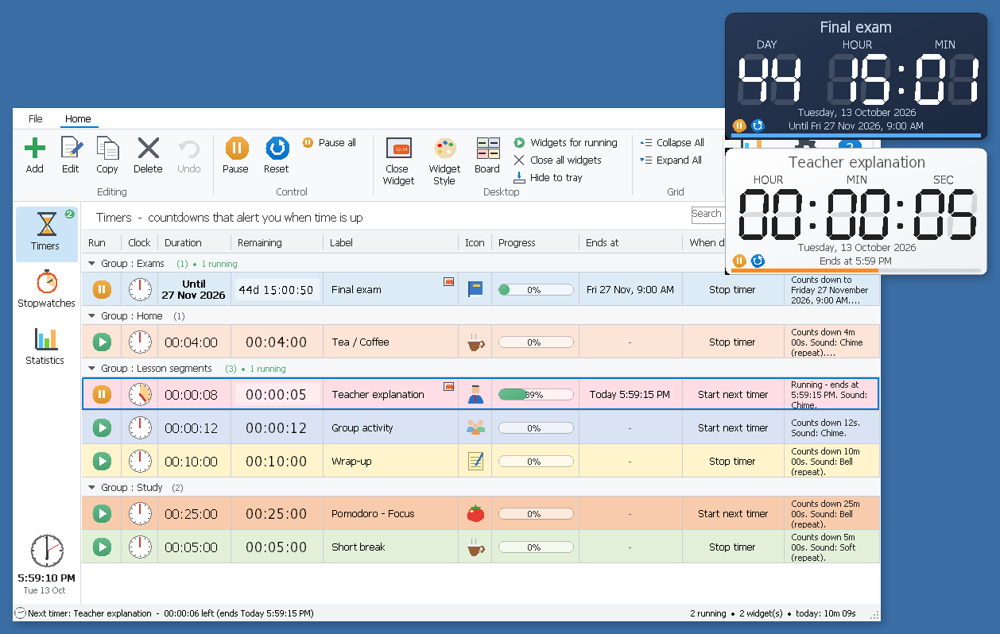
*The main window, with timers sorted into coloured groups. Two of them are floating on the desktop as widgets (top right).*

---

## Contents

1. [Download and install](#1-download-and-install)
2. [Getting started in 1 minute](#2-getting-started-in-1-minute)
3. [Timers and exam countdowns](#3-timers-and-exam-countdowns)
4. ["When done" actions](#4-when-done-actions)
5. [Chained timers (lessons and Pomodoro)](#5-chained-timers-lessons-and-pomodoro)
6. [Desktop widgets](#6-desktop-widgets)
7. [Board view for the classroom](#7-board-view-for-the-classroom)
8. [Stopwatches and named laps](#8-stopwatches-and-named-laps)
9. [Statistics](#9-statistics)
10. [Settings, backup and restore](#10-settings-backup-and-restore)
11. [Security and tamper protection](#11-security-and-tamper-protection)
12. [Keyboard shortcuts](#12-keyboard-shortcuts)
13. [Questions and answers](#13-questions-and-answers)
14. [For developers](#14-for-developers)

---

## 1. Download and install

Download the files from the **Releases** page of this GitHub repository (in the project folder they are in **`release`**).

| File | What it is |
|---|---|
| **`StudentTimerClock version 0.3.exe`** | **The installer. Recommended.** It includes everything, so you don't need to install anything else. |
| `StudentTimerClock version 0.3 (portable, needs NET 8).zip` | Portable version with no installer. Unzip it and keep the 3 files together. It needs the free [.NET 8 Desktop Runtime](https://dotnet.microsoft.com/download/dotnet/8.0) (x64). |
| `StudentTimerClock version 0.3 - Certificate of Integrity.pdf` | The official release record. It lists the version, the fingerprint (SHA-256) of every file, and the digital-signature details. |
| `SHA256SUMS.txt`, `*.cer` | Checksums and public certificates, for checking that your download is genuine. |

### Installing

Double-click **`StudentTimerClock version 0.3.exe`** and follow the steps:

<table>
<tr>
<td width="33%">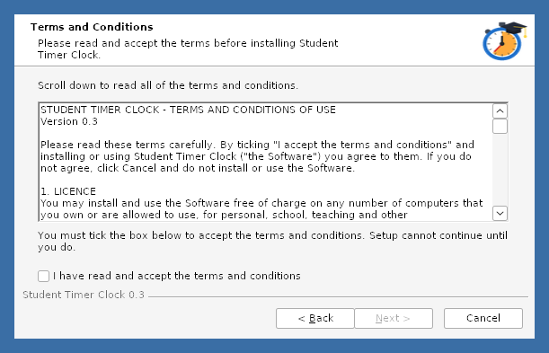</td>
<td width="33%">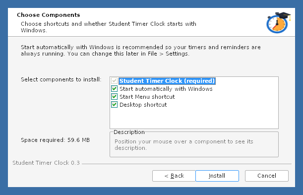</td>
<td width="33%">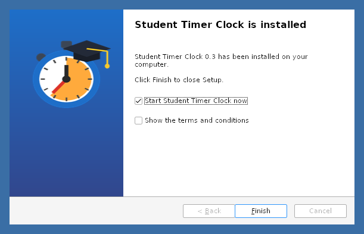</td>
</tr>
<tr>
<td><b>1. Terms &amp; Conditions.</b> The <i>Next</i> button stays greyed out until you tick <i>"I have read and accept the terms and conditions"</i>.</td>
<td><b>2. Components.</b> <i>Start automatically with Windows</i> is ticked by default, so your timers are ready when you sign in. You can untick it here or change it later.</td>
<td><b>3. Finished.</b> Leave <i>"Start Student Timer Clock now"</i> ticked and click <b>Finish</b>.</td>
</tr>
</table>

- It installs **just for you** in `%LOCALAPPDATA%\Programs\StudentTimerClock`, so no administrator password is needed.
- It creates Start Menu and Desktop shortcuts.
- On the last page you can start the app right away.
- **Uninstall:** use *Windows Settings → Apps*, or *Uninstall Student Timer Clock* in the Start Menu. It asks whether you want to keep your data.

> **"Windows protected your PC" / "Unknown publisher"?**
> The app is digitally signed, but with the project's own certificate rather than one bought from a commercial authority, so Windows doesn't recognise the publisher yet. Click **More info → Run anyway**. See [Security](#11-security-and-tamper-protection) for how to check the download is genuine.

---

## 2. Getting started in 1 minute

1. Click **Timers** on the left, then **Add** (or press **Ctrl+N**).
2. Give the timer a name, e.g. *"Homework"*, and set the duration. Pick a colour, an icon and a sound if you like.
3. Click the green **▶** in the *Run* column, or press **Space**, to start it.
4. Click **Float Widget** (or press **Ctrl+W**) to put the timer on your desktop.

When the time is up, a reminder pops up and the sound plays. You can **Dismiss**, **Restart** or **snooze**.

---

## 3. Timers and exam countdowns

The **Timers** page lists all your countdowns in coloured **groups**, such as *Exams*, *Home*, *Lesson segments* and *Study*. Each row shows:

| Column | Meaning |
|---|---|
| **Run** | ▶ start / ⏸ pause |
| **Duration / Remaining** | the full time and the time left |
| **Progress** | how much of the time has passed |
| **Ends at** | the exact finish time in AM/PM, e.g. *Today 5:59:15 PM* |
| **When done** | what happens when time is up (see the next section) |

**Exam countdown:** when you add or edit a timer, choose **"Count down to a date & time"** and pick the date of your exam, holiday or deadline. The timer shows the **days, hours and minutes** left. The example *Final exam* shows *44 days 15 hours*.

Tips:

- Double-click a timer, or press **F2**, to edit it.
- **Ctrl+D** makes a copy and **Ctrl+Z** undoes a delete.
- **Ctrl+F** searches, and **Collapse All / Expand All** fold the groups.
- The status bar at the bottom always shows the **next timer to finish**.

---

## 4. "When done" actions

Every timer can do things automatically when it reaches zero. Edit a timer, open the **When done (actions)** tab and click **Add…**. Choose an action on the left and fill in its details on the right. Click **Test** to try it out.

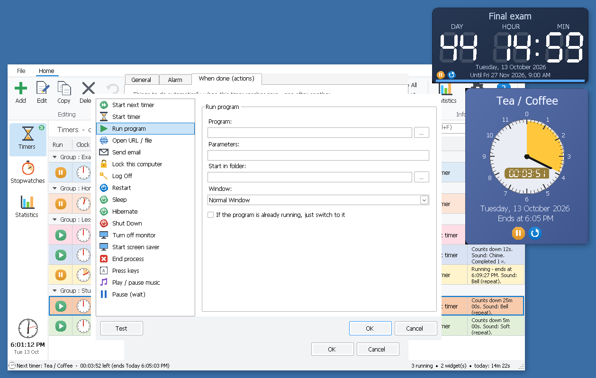

The available actions:

| | |
|---|---|
| **Timers** | Start next timer · Start timer · Pause (wait) between actions |
| **Programs and web** | Run program · Open URL / file · Send email · End process (e.g. close a game) · Press keys · Play / pause music |
| **Computer** | Lock · Log off · Sleep · Hibernate · Restart · Shut down · Turn off monitor · Screen saver |

**Safety first:** restart, shut down, log off, sleep and hibernate always show a **30-second countdown** first, so you can cancel and save your work.

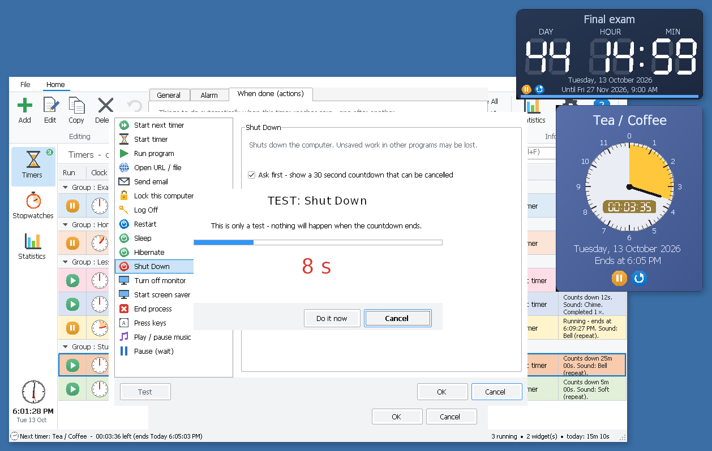
*Testing the "Shut down" action: nothing happens until the countdown ends, and you can click Cancel.*

---

## 5. Chained timers (lessons and Pomodoro)

Give a timer the action **Start next timer** and it starts the following timer in its group the moment it finishes. The desktop widget moves on to the new timer automatically.

- **Lesson:** *Teacher explanation → Group activity → Wrap-up*
- **Pomodoro:** *Focus 25 min → Short break 5 min*

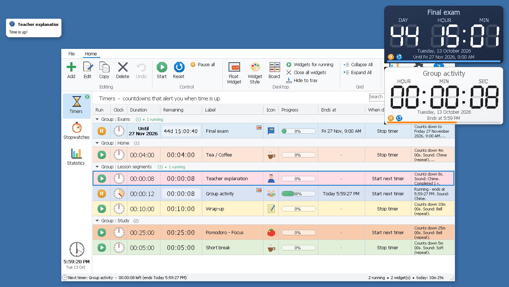
*"Teacher explanation" has just finished ("Time is up!", top left). "Group activity" started by itself, and the widget switched to it.*

---

## 6. Desktop widgets

Select a timer or stopwatch and click **Float Widget** (**Ctrl+W**). The widget stays on your desktop, even when the main window is hidden in the system tray.

- **Move it:** drag it anywhere. It snaps to screen edges and to other widgets.
- **Resize it:** drag its bottom-right corner.
- **Use it:** hover over it to show the **▶ / ↺** buttons, the **brush** (style) and **×** (close).

### Make it yours

Click the brush on a widget, right-click it, or use **Widget Style** in the toolbar. A **live preview** shows every change straight away.

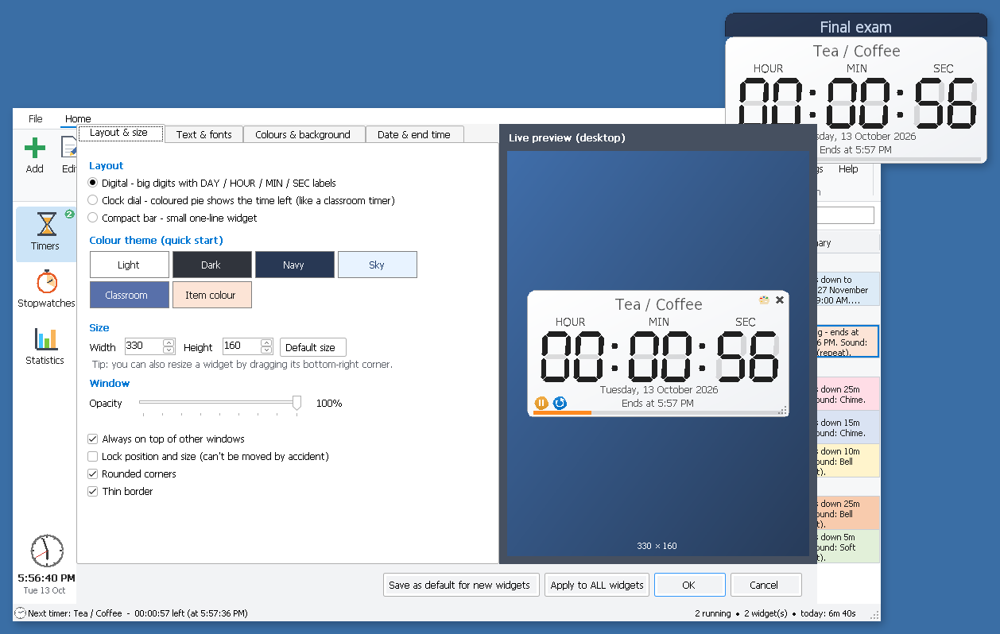

| Tab | What you can change |
|---|---|
| **Layout & size** | **Digital** (big digits with DAY / HOUR / MIN / SEC), **Clock dial** (a coloured pie shows the time left, like a classroom timer) or **Compact bar**. Colour themes, size, opacity, always on top, lock position, rounded corners. |
| **Text & fonts** | Your own title text (e.g. *"Good morning my dear"*), the title font, the digit font (any installed font or the built-in LCD), bold and italic, and whether to show seconds. |
| **Colours & background** | Digit and label colours, plus a background colour, gradient or **your own picture**. |
| **Date & end time** | Shows the date and the **finish time in AM/PM** under the timer (e.g. *"Ends at 5:57 PM"*), or 24-hour if you prefer. Also a progress bar. |

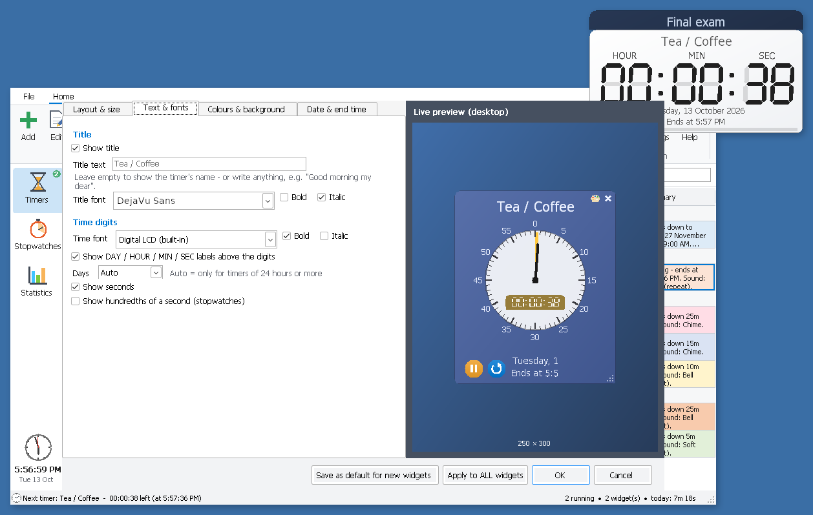
*The "Clock dial" layout in the live preview.*

You can apply a style to **one widget** or to **all widgets**, or **save it as the default** for new ones.

---

## 7. Board view for the classroom

Press **Ctrl+B**, or click **Board**, to show your timers and stopwatches as big coloured tiles. It's ideal for a projector or a second screen.

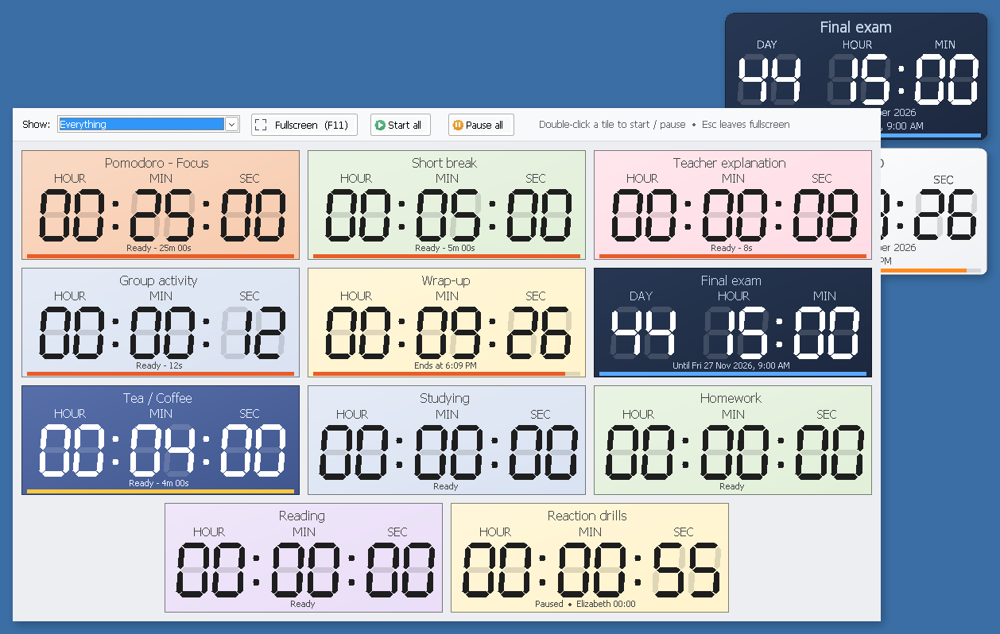

- **Show:** running items, all timers, all stopwatches, everything, or one group.
- **F11** switches fullscreen on and off, and **Esc** leaves fullscreen.
- **Start all / Pause all**, or double-click a tile to start or pause it.

---

## 8. Stopwatches and named laps

Use the **Stopwatches** page to track how long you spend on things. Make one stopwatch per activity, such as *Studying*, *Homework* or *Reading*.

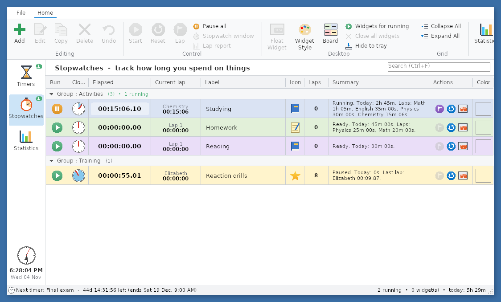

**Named laps** split one stopwatch into subjects. While *Studying* is running, type *"Math"* as the current lap. When you switch to English, press **Lap** (or **L** / **Enter**) and type *"English"*. The *Summary* column then shows today's time per lap, e.g. *"Math 1h 05m, English 35m 00s, Physics 30m 00s…"*.

Double-click a stopwatch to open its big window. **Lap report** draws a bar or pie chart of the laps, grouped by name.

---

## 9. Statistics

The **Statistics** page shows **how long you did what**. It covers timers, stopwatches **and every named lap**, all in one chart.

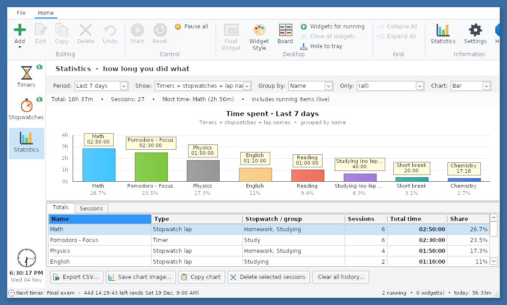
*Last 7 days, grouped by name. "Math" adds up the Math laps from both the Studying and Homework stopwatches.*

- **Period:** today, yesterday, this week, the last 7 / 30 days, this month, this year, all time, or a custom range.
- **Show:** timers + stopwatches + lap names (the default), lap names only, stopwatches only, or timers only.
- **Group by:** name, group, type or day. **Chart:** bar or pie.
- **Totals tab:** name, type, sessions, total time and share, with a TOTAL row. Double-click a row to see its individual sessions.
- **Sessions tab:** every start and stop with its date, time and duration.
- **Export CSV…** (opens in Excel), **Save chart image…** and **Copy chart**.

<table>
<tr>
<td width="50%">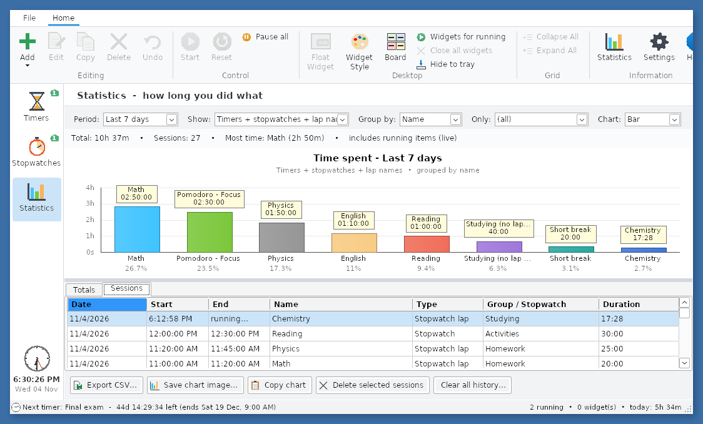</td>
<td width="50%">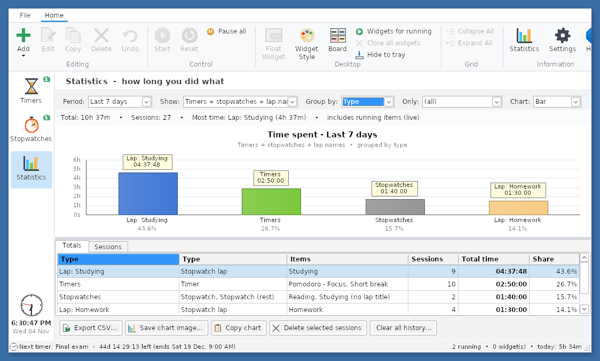</td>
</tr>
<tr>
<td>The <b>Sessions</b> tab: every single session.</td>
<td><b>Group by: Type</b> compares timers, stopwatches and laps.</td>
</tr>
</table>

---

## 10. Settings, backup and restore

Open **Settings** from the toolbar or the File menu.

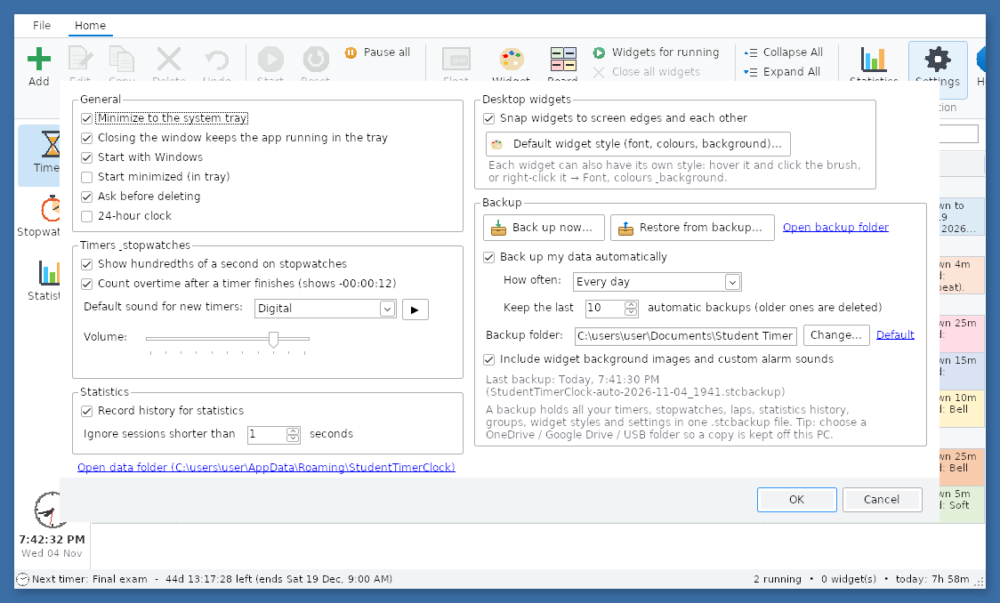

**General:**

- minimise to the system tray
- **start with Windows**
- ask before deleting
- 24-hour clock
- hundredths of a second on stopwatches
- default sound and volume
- widget snapping and the default widget style

### Backup

- **Back up now…** saves *everything* into one `.stcbackup` file: timers, stopwatches, laps, statistics, groups, widget styles and settings. It can also include your own pictures and sounds.
- **Automatic backups** are **on** by default, once a day, and keep the last 10. They go to `Documents\Student Timer Clock Backups`.
  - Tip: choose a **OneDrive, Google Drive or USB** folder so you always have a copy that isn't on this PC.
- **Restore from backup…** brings it all back, on this PC or a new one.
  - Your current data is backed up automatically first, so a restore can always be undone.
  - The app then restarts by itself.

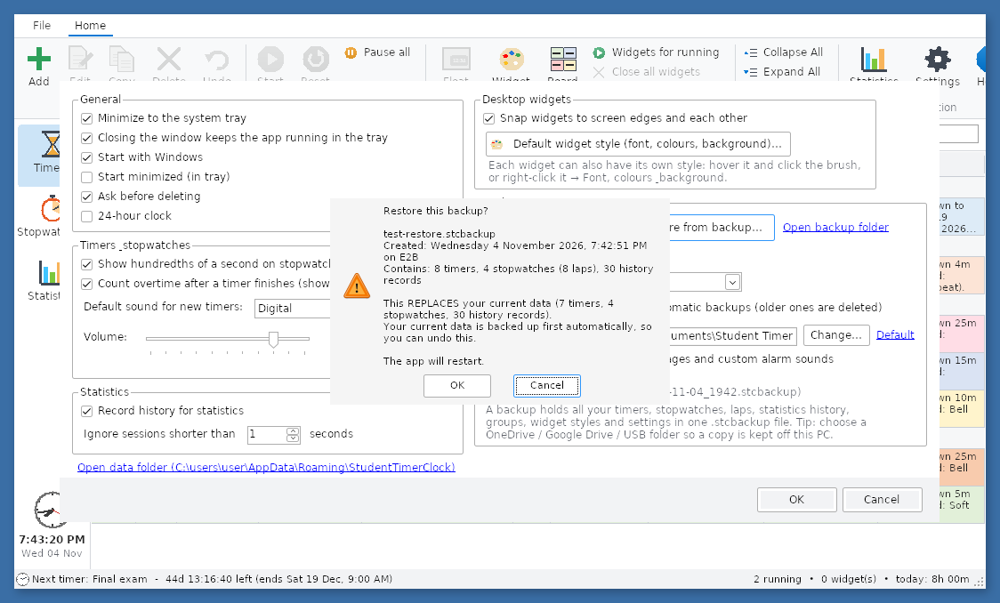

If your data file is ever damaged, the app offers to restore your latest backup when it starts.

---

## 11. Security and tamper protection

Student Timer Clock protects itself against tampering:

- **Digitally signed.** The program, the installer and the uninstaller carry a digital signature with a trusted timestamp.
- **Checks itself.** When it starts, and again every few minutes while it runs, the app checks its own signature and SHA-256 fingerprint. It also checks that no unknown files were added to its folder and that no foreign code was injected into it.
- **Stops if something is wrong.** If it finds a problem, it tells you, writes the reason to a security log and closes itself. **Your timers and history are never touched.** Just reinstall from the official installer.
- **Strict input checking.** Everything you type is validated, so a timer name or action can't be used to run hidden commands.
  - "When done" actions that come from a backup, or from a data file that was changed outside the app, are blocked (**⚠ BLOCKED**) until you confirm them.

<table>
<tr>
<td width="55%">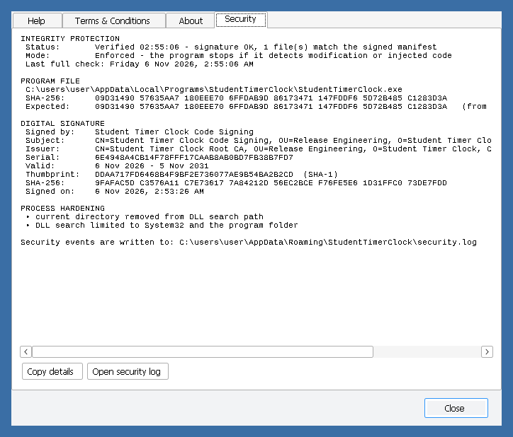</td>
<td width="45%">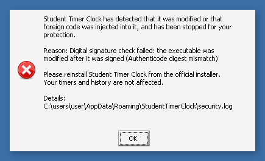</td>
</tr>
<tr>
<td><b>Help → Security</b> shows the live status: the program's fingerprint, the certificate, and when the last check ran.</td>
<td>The message you see if the program was modified. The modified program stops before it can do anything.</td>
</tr>
</table>

### Check that your download is genuine

Open **PowerShell** in the folder with the download and run:

```powershell
Get-FileHash ".\StudentTimerClock version 0.3.exe" -Algorithm SHA256
Get-AuthenticodeSignature ".\StudentTimerClock version 0.3.exe" | Format-List Status, SignerCertificate
```

The hash must match `SHA256SUMS.txt` and the **Certificate of Integrity** PDF. You can also right-click the file → **Properties → Digital Signatures** to see the signature.

**Good to know:**

- **Self-signed certificate:** the certificate comes from the project's own certificate authority, so Windows shows *"Unknown publisher"*.
  - A school or organisation can install `Student Timer Clock Root CA.cer` as a trusted certificate, for example through Group Policy, to remove the warning on its PCs.
- **Installer vs portable:** the installed version has the strongest protection. If you use the portable version, keep its folder somewhere only you can write to.
- **Limits:** no app can completely stop someone with administrator rights on their own computer from changing it. These checks make sure any change is **detected**.

---

## 12. Keyboard shortcuts

| Keys | Action | Keys | Action |
|---|---|---|---|
| **Ctrl+N** | new timer / stopwatch | **Space** | start / pause |
| **F2** / **Enter** | edit | **L** | lap (stopwatch) |
| **Del** | delete | **Ctrl+W** | float a widget |
| **Ctrl+D** | copy | **Ctrl+B** | Board view |
| **Ctrl+Z** | undo | **F11** | fullscreen (Board) |
| **Ctrl+F** | search | **Ctrl+1 / 2 / 3** | Timers / Stopwatches / Statistics |

---

## 13. Questions and answers

**Where is my data stored?**
In `%APPDATA%\StudentTimerClock\data.json`, on your computer only. The app collects nothing, shows no ads, and doesn't need the internet. *Help → About → Open data folder* takes you there.

**How do I stop it starting with Windows?**
Go to *File → Settings → untick "Start with Windows"*, or use Task Manager → *Startup apps*.

**I closed the window but the app is still running.**
That's on purpose, so your timers and widgets keep working. It's in the **system tray** next to the clock. To quit, right-click its icon and choose *Exit*.

**How do I move everything to a new computer?**
*Settings → Back up now…* on the old PC, copy the `.stcbackup` file, then *Restore from backup…* on the new one.

**The app said "integrity check failed" and closed.**
A file of the program was changed or an unknown file was added to its folder, for example by malware or a broken update. Reinstall from the official installer. Your data is safe.

**Can I keep data on a USB stick (portable mode)?**
Yes. Use the portable version and put an empty file named `portable.txt` next to `StudentTimerClock.exe`. The data is then kept in that folder.

---

## 14. For developers

**Build a signed release** (Linux or Windows with bash):

```bash
scripts/build-release.sh
```

The script:

- publishes the app
- signs it
- writes the signed integrity manifest
- builds and signs the NSIS installer
- verifies every signature
- writes `SHA256SUMS.txt`
- generates the PDF *Certificate of Integrity* in `release/`

It needs the .NET 8 SDK, NSIS ≥ 3.08, osslsigncode, openssl, zip, and Python 3 with `cryptography` and `reportlab`.

To sign with a commercial certificate, run `SIGN_PFX=cert.pfx SIGN_PASSWORD_FILE=pw.txt scripts/build-release.sh`.

**Development build:** `cd src && dotnet build`. Integrity checks then only *report*, so debugging works.

| Folder | Contents |
|---|---|
| `src/` | C# / WinForms source code (.NET 8); `src/Security/` holds the integrity, signature and validation code |
| `installer/` | NSIS installer script, terms and conditions, artwork |
| `scripts/` | release build, signing, manifest, PDF record and README image scripts |
| `signing/` | public certificates. **`signing/private/` holds the secret signing keys: never share or upload it.** |
| `docs/images/` | the pictures used in this README (made by `scripts/make_doc_images.py`) |
| `release/` | the finished, signed release files |

---

## Licence

Student Timer Clock is licensed under the **[PolyForm Noncommercial License 1.0.0](LICENSE)**.

- ✅ **Allowed:**
  - use it for free, at home, at school, or in a charity or other non-profit
  - share it
  - change it for non-commercial purposes
- ❌ **Not allowed:** selling it, or using it to make money (commercial use).

The full terms are in the [`LICENSE`](LICENSE) file. The app's Terms & Conditions are in the installer and under *Help → Terms & Conditions*.

*Student Timer Clock 0.3 · Copyright © 2026 Abdelrhman914*
